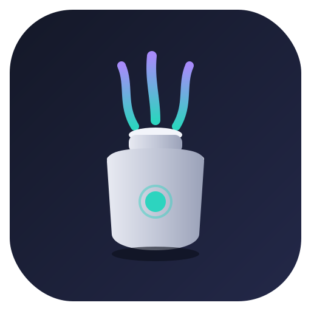

<p align="center">
  
</p>

# Scent Smart

Controle local de difusores de aromas BLE **Scent / YooAI (GAS-501F e família)** no Home Assistant — sem app do fabricante, sem nuvem, sem limites artificiais.

> Testado ponta a ponta com o difusor Scent-B501F (GAS-501F), incluindo validação contra o app oficial.

## Instalação

**HACS (recomendado):**
1. HACS → Integrations → menu → *Custom repositories*
2. Adicione `https://github.com/megahitz/scent-smart` (categoria *Integration*)
3. Baixe **Scent Smart** e reinicie o Home Assistant

**Manual:** copie `custom_components/scent_smart/` para `/config/custom_components/` e reinicie.

Depois: *Configurações → Dispositivos e serviços → Adicionar integração → Scent Smart* (o endereço BLE pode ser digitado manualmente).

## Entidades

| Entidade | Função |
|---|---|
| `button` Borrifar Agora | Borrifada única com restauração automática do ciclo |
| `switch` Modo de Trabalho | Liga/desliga o ciclo autônomo (running status) |
| `number` Tempo de Borrifada | 5–200 s (passo 5) — gravado no aparelho |
| `number` Tempo de Pausa | 20–300 s (passo 5) — gravado no aparelho |
| `sensor` Estado | Running/Idle/Off + diagnóstico (dump BLE bruto) |

Entidades avançadas (5 programas, ventilador, trava infantil, luz ambiente) existem desabilitadas por padrão — habilite em *Configurações → Entidades* se precisar.

## Arquitetura

**Conexão sob demanda** — o aparelho emite um bip a cada conexão BLE, então a integração conecta apenas quando necessário e desconecta em seguida:

- **No boot** do Home Assistant: conecta, lê o estado e reaplica a configuração salva
- **Em comandos**: um beep por ação intencional, silêncio absoluto no resto do dia

## Automações

```yaml
# Difusor liga com presença em casa, desliga quando vazia
automation:
  - alias: Aroma — ligar com presença
    triggers:
      - trigger: state
        entity_id: binary_sensor.home_occupied
        to: "on"
    actions:
      - action: switch.turn_on
        target:
          entity_id: switch.sala_de_estar_difusor_aroma_modo_de_trabalho

  - alias: Aroma — borrifar ao abrir a porta
    triggers:
      - trigger: state
        entity_id: binary_sensor.porta_de_entrada
        to: "on"
    actions:
      - action: button.press
        target:
          entity_id: button.sala_de_estar_difusor_aroma_borrifar_agora
```

## Compatibilidade

Testado com o **Scent-B501F** (GAS-501F). O serviço BLE é `FFE0`/`FFE1` — outros modelos da família podem funcionar; o protocolo completo está em [`docs/protocolo.md`](docs/protocolo.md).

## Notas

- O aparelho aceita **uma única conexão central BLE por vez** — feche o app do fabricante ao usar a integração.
- Os tetos do app oficial (spray 5–200 s, pausa 20–300 s) são respeitados; integrações antigas limitavam a 8 s/600 s.
